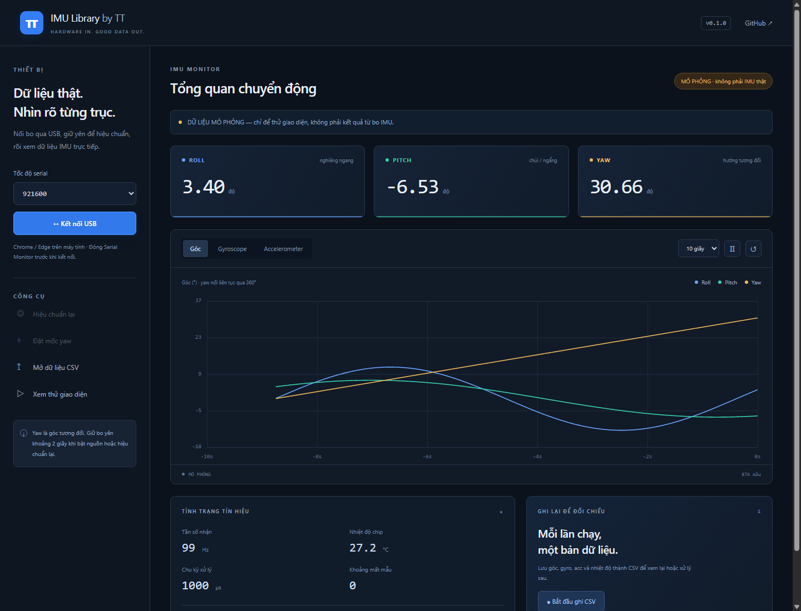

# IMU Library by TT

Thư viện C++ xử lý IMU 6 trục cho **ESP32 / STM32**, với lõi tính góc port từ **INAV 9.0.1**.

**v0.1.4 — bản thử nghiệm:** sửa lỗi giao diện mới tải lẫn CSS/JS cũ; không cần nạp lại firmware v0.1.3. Có 7 đồ thị cùng lúc, trạng thái/nhiệt độ ở đầu trang; profile FC đã đổi dấu roll từ v0.1.3. Kiểm tra dài hạn trên bo còn chờ đo.

## Có gì?

- ICM42605, ICM42688-P, MPU6500: SPI hoặc I²C. MPU6050: I²C.
- Tự hiệu chuẩn gyro khi khởi động; rung thì tự thử lại.
- Bộ lọc gyro/acc, gyro Kalman, quaternion và roll/pitch/yaw độ phân giải float.
- Đọc thêm gyro (rad/s), acc (m/s²), nhiệt độ, timestamp và trạng thái sẵn sàng.
- Trang HTML xem đồ thị qua USB, mở/ghi CSV, hiệu chuẩn lại và đặt mốc yaw.
- Lõi không cấp phát heap khi chạy. Có interface để dùng ESP-IDF/STM32 HAL ngoài Arduino.

## Dùng trong dự án PlatformIO

Thêm vào environment của robot trong `platformio.ini`, giữ cấu hình board/pin của dự án:

```ini
lib_deps =
    https://github.com/thamtrung151/IMU-Library-by-TT.git#v0.1.4
```

Adapter có sẵn dùng `framework = arduino` **trong PlatformIO**, không cần Arduino IDE. Repo riêng tư cần Git trên máy đăng nhập tài khoản có quyền truy cập. Ghim tag để dự án giữ đúng phiên bản thư viện.

Muốn sửa thư viện trên máy và dùng ngay trong robot, thay URL bằng:

```ini
lib_deps =
    symlink://C:/Users/VICTUS/IMU Library by TT
```

Mẫu dự án độc lập: [platformio.ini](examples/PlatformIO_Robot/platformio.ini) và [src/main.cpp](examples/PlatformIO_Robot/src/main.cpp). Copy thư mục `PlatformIO_Robot`, sửa board/pin rồi Build/Upload. Mẫu này lấy dữ liệu cho bộ điều khiển, không tự gửi đồ thị.

## Nối dây và chạy

**FC F411 + ICM42605 / thạch anh 8 MHz / SPI2 CS PC13:** dùng environment `tt_f411_icm42605`. Hướng dẫn riêng: [nạp FC và kết nối USB](docs/FC_F411.md). Profile này có clock riêng, không dùng clock 25 MHz của BlackPill.

Ví dụ SPI: sửa pin cho đúng bo của bạn, dùng logic **3,3 V**, chung GND.

| IMU | ESP32-S3 trong ví dụ | STM32F411 trong ví dụ |
|---|---|---|
| SCK | GPIO12 | PA5 |
| SDO / MISO | GPIO13 | PA6 |
| SDI / MOSI | GPIO11 | PA7 |
| CS | GPIO10 | PA4 |

I²C dùng SDA/SCL của bo, địa chỉ thường `0x68` hoặc `0x69`. MPU6050 không dùng SPI.

Để chạy ví dụ đồ thị ngay từ repo thư viện: sửa pin trong [ESP32-S3 SPI](examples/SerialPlotter/SerialPlotter.ino), [STM32 SPI](examples/STM32_SPI/STM32_SPI.ino) hoặc [MPU6050 I²C](examples/MPU6050_I2C/MPU6050_I2C.ino), rồi chạy:

```sh
pio run -e esp32s3 -t upload
```

Environment khác: `stm32f411`, `esp32s3_i2c`, `stm32f411_i2c`. Giữ IMU đứng yên khoảng **2 giây** khi khởi động. `platformio.ini` ở gốc repo dành cho các ví dụ này; dự án robot dùng cấu hình riêng như phần trên.

Cách lấy dữ liệu sau khi đã khởi tạo như ví dụ:

```cpp
void loop() {
    if (imu.update() && imu.ready()) {
        const auto& d = imu.data();
        // d.roll, d.pitch, d.yaw       : độ
        // d.quaternion.w/x/y/z
        // d.gyro.x/y/z                : rad/s
        // d.accel.x/y/z               : m/s², gồm trọng lực
        // Đưa dữ liệu vào bộ điều khiển của bạn ở đây.
    }
}
```

Gọi `update()` thường xuyên, tránh `delay()` trong vòng đọc. Mặc định lấy mẫu/tính góc 1 kHz, phù hợp cả SPI/I²C. Muốn thử ICM qua SPI ở mức 4 kHz/2 kHz: truyền `ttimu::Config::inav9()` vào `begin()`.

## Xem đồ thị

Nạp một ví dụ ở trên (cả SPI/I²C đều gửi cùng định dạng đồ thị), đóng Serial Monitor rồi chạy trong thư mục repo:

```sh
python tools/serve_viewer.py
```

Trên Windows nhấp đúp **Start Viewer.cmd**, dùng trang tự mở bằng Chrome/Edge → **Kết nối USB**, baud `921600`. Mặc định là localhost:8080; nếu cổng đó đang có server cũ, launcher tự chọn cổng trống và mở đúng URL. CSS/JS tự đổi mã theo nội dung để tránh cache cũ. Góc lớn và sáu đồ thị gyro/acc hiện cùng lúc; rê chuột đọc cùng một thời điểm, bấm nhãn góc để ẩn/hiện đường. Nút **Mô phỏng** luôn có nhãn riêng.

Các cấu hình PlatformIO STM32 kèm repo bật USB CDC cho BlackPill; nếu dùng USB–UART ngoài, chọn Serial và pin phù hợp bo.



## Tiến độ

- [x] Lõi góc INAV 9, hiệu chuẩn gyro, lọc và API C++.
- [x] Driver bốn IMU, ví dụ ESP32-S3/STM32, giao diện đồ thị/CSV.
- [x] Kiểm tra trên máy và biên dịch chéo cho ESP32-S3/STM32F411.
- [x] Phân tích hai log đứng yên trên FC thực; sửa khởi tạo tư thế và cấu hình trục. [Kết quả debug](reports/2026-11-07-stationary/README.md).
- [ ] Kiểm tra từng IMU trên bo thật, đo drift/nhiệt/rung và chỉnh profile theo log.
- [ ] Hoàn thiện hiệu chuẩn acc 6 tư thế, bù nhiệt và các tối ưu theo kết quả đo.

Yaw là hướng **tương đối**, không phải la bàn. Bản này dùng profile dành cho robot, không chứa toàn bộ flight stack/bộ lọc theo động cơ của INAV. Chi tiết cho người sửa code: [API](docs/API.md), [nguồn và thay đổi](docs/PORTING.md), [kiểm thử](docs/TESTING.md).

**GPL-3.0-or-later** — kế thừa mã INAV; xem [giấy phép](LICENSE) và [ghi nhận nguồn](THIRD_PARTY_NOTICES.md).
